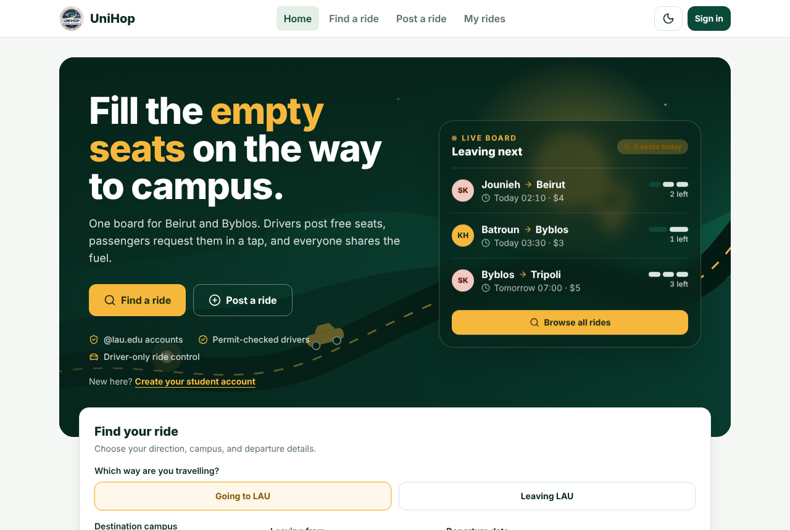
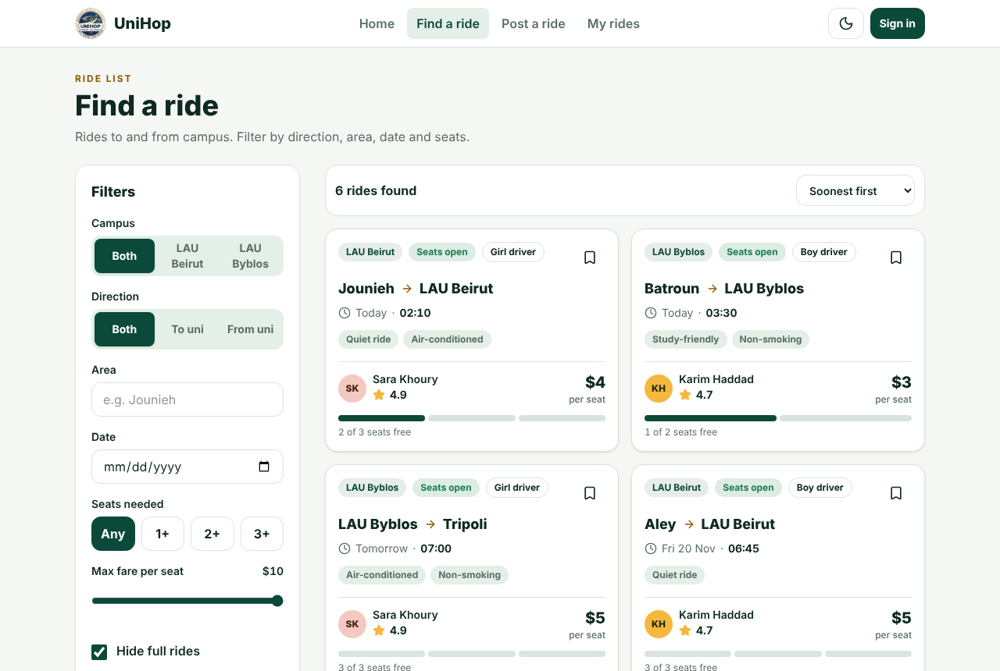
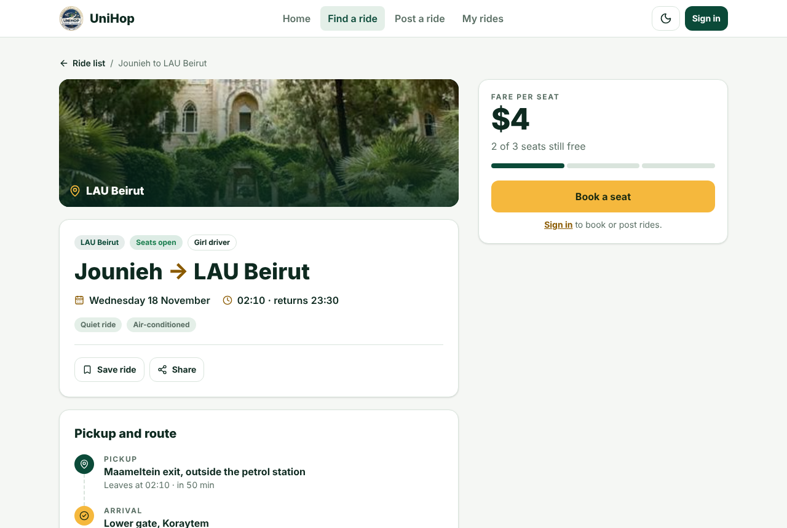
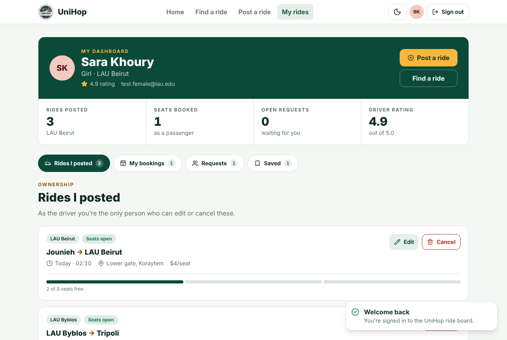
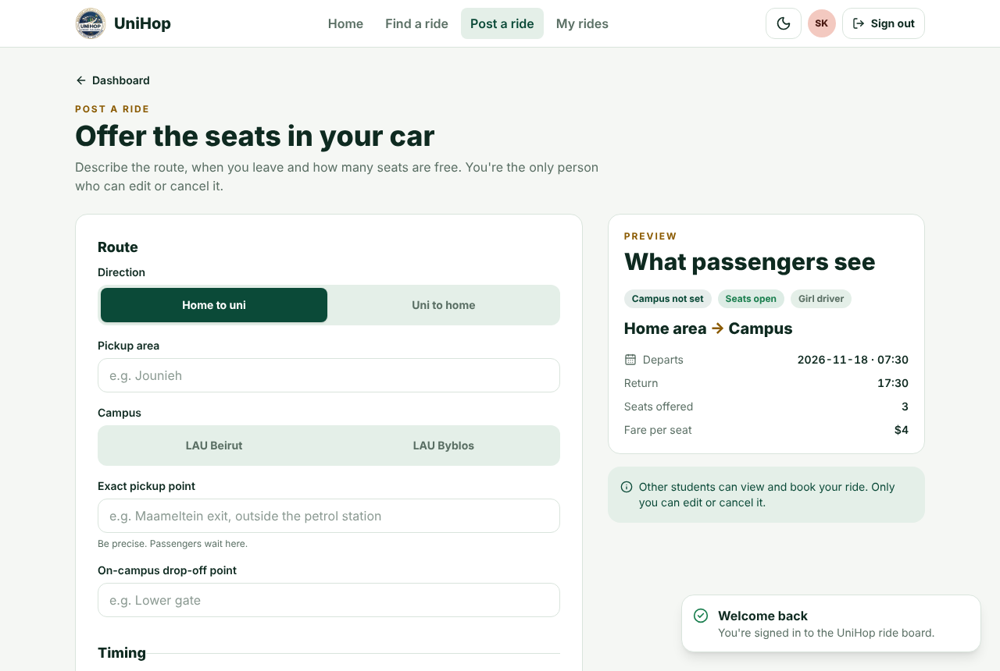
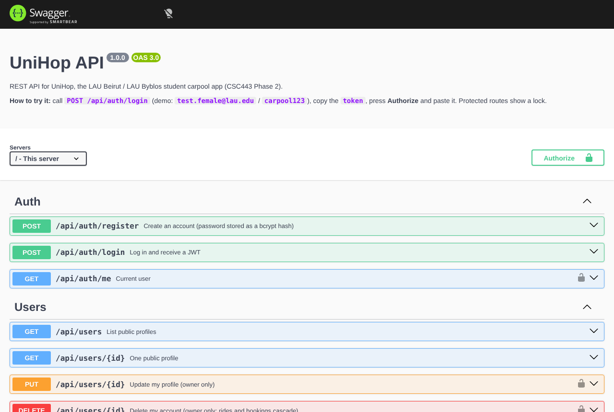

# UniHop

Student ride-share for LAU Beirut and LAU Byblos. Students driving to campus post rides with open seats; other students request and book them.

**Team:** Callback Crew
**Members:** Abdulrahman Al Issa, Hassan Tohme, Mohammad Zaiter
**Course:** CSC443, Fall 2026, Project Phase 2 (full-stack)

| | Link |
|---|---|
| Live frontend | https://unihop-black.vercel.app |
| Live backend API | _paste your Render URL here, e.g. https://unihop-api.onrender.com_ |
| Swagger (API docs and testing) | _backend URL_`/api/docs` |
| Repository | https://github.com/Abdulrahman-alissa/UniHop |

> The free Render plan puts the API to sleep after inactivity. The first request can take up to a minute; the app shows a "waking up the server" message while it waits.

**Demo logins** (password `carpool123` for all): `test.female@lau.edu`, `test.female2@lau.edu`, `test.male@lau.edu`, `test.male2@lau.edu`

## Assigned topic and data entities

Topic: **Campus Carpool**, built as the app **UniHop**, for the **LAU Beirut** and **LAU Byblos** campuses.

| Entity | Table | Main fields |
|---|---|---|
| Users (also the drivers) | `users` | id, name, email (unique), password_hash (bcrypt), campus, gender, rating, phone, bio, car (JSONB) |
| Rides | `rides` | id, driver_id → users, direction (`toCampus`/`fromCampus`), girls_only, origin_area, origin_label, campus, meeting_point, depart_at, return_at, seats_total, price_per_seat, notes, tags, status (`open`/`cancelled`/`completed`) |
| Bookings | `bookings` | id, ride_id → rides, passenger_id → users, seats, status (`pending`/`confirmed`/`declined`/`cancelled`), note |
| Saved rides | `saved_rides` | user_id → users, ride_id → rides |

Relationships: a user **drives many** rides; a ride **has many** bookings; a user **makes many** bookings. Deleting a user or ride cascades to what depends on it. A partial unique index stops one passenger holding two live bookings on the same ride.

Business rules enforced by the API:
- **Only the driver can edit, cancel or delete their ride.** Everyone else gets `403`.
- **Girls-only rides:** only girl accounts can post them, see them in lists, open them or book them.
- Seats are checked inside a database transaction with the ride row locked, so two people can never take the last seat. A ride can't be edited down below its already-booked seats.
- Only the driver confirms or declines a request; only the passenger cancels their own booking. Cancelling a ride cancels its bookings.

## Technologies

- **Frontend:** React 19, React Router (HashRouter), Tailwind CSS v4, Vite, lucide-react
- **Backend:** Node.js, Express 5, `pg` (PostgreSQL), `bcrypt`, `jsonwebtoken`, `zod` (validation), `helmet`, `cors`, `morgan` (logging), `express-rate-limit`, `swagger-ui-express`
- **Database:** PostgreSQL (hosted on Render or Neon)
- **Deployment:** Render (API + database), Vercel (frontend)

## Project structure

```
UniHop/
├── src/                  React app (pages, components, store.jsx, lib/api.js)
├── backend/
│   ├── src/
│   │   ├── app.js, server.js, config.js
│   │   ├── routes/       auth.js, users.js, rides.js, bookings.js, saved.js
│   │   ├── middleware/   auth.js (JWT), validate.js, errors.js
│   │   ├── db/           schema.sql, pool.js, seed.js, mappers.js, rides.js
│   │   ├── docs/openapi.js   Swagger definition
│   │   └── schemas.js    request validation (zod)
│   └── test/api.test.js  integration tests (real PostgreSQL)
├── render.yaml           Render blueprint (API + database)
└── docs/                 team split, screenshots
```

## Run locally

Requires Node 18+ and PostgreSQL.

**1. Database**
```bash
createdb unihop
```

**2. Backend** (http://localhost:4000)
```bash
cd backend
cp .env.example .env      # set DATABASE_URL (and JWT_SECRET)
npm install
npm run dev               # creates the tables and loads demo data on first start
```
Swagger UI: http://localhost:4000/api/docs. Reset demo data any time with `npm run seed -- --reset`.

**3. Frontend** (http://localhost:5173)
```bash
# from the repository root
cp .env.example .env      # VITE_API_URL=http://localhost:4000
npm install
npm run dev
```

**Tests** (they wipe the tables of the database you point them at, so use a separate one):
```bash
createdb unihop_test
cd backend && DATABASE_URL=postgresql://localhost/unihop_test npm test
```

### Environment variables (backend)

| Variable | Purpose |
|---|---|
| `DATABASE_URL` | PostgreSQL connection string (TLS turned on automatically for `sslmode=require` or `DATABASE_SSL=true`) |
| `JWT_SECRET` | Secret used to sign tokens. **Required in production.** |
| `JWT_EXPIRES_IN` | Token lifetime, default `7d` |
| `CORS_ORIGIN` | Allowed frontend origin(s), comma separated |
| `AUTO_SEED` | `true` loads demo users and rides when the database is empty (and refreshes demo rides when none are upcoming) |
| `ALLOWED_EMAIL_DOMAIN` | Default `lau.edu`; registration only accepts this domain |

## Deployment

**Backend + database (Render):** push the repo, then Render > New > **Blueprint** and select it. `render.yaml` creates the web service (root `backend`) and a PostgreSQL database and generates `JWT_SECRET`. After the first deploy, set `CORS_ORIGIN` to the frontend URL. Without a blueprint: create a Render PostgreSQL, then a Web Service with root directory `backend`, build `npm install`, start `npm start`, and the variables above. (Neon or Supabase also work as the database: paste their connection string into `DATABASE_URL`.)

**Frontend (Vercel/Netlify):** build command `npm run build`, output `dist`, environment variable `VITE_API_URL` = the Render URL (no trailing slash). Redeploy after changing it. For GitHub Pages, add `VITE_API_URL` as an Actions repository variable.

## API documentation

Interactive docs and a "Try it out" console are at **`/api/docs`** (raw spec: `/api/docs.json`). Click **Authorize** and paste the token from login to call protected routes.

Authentication: send `Authorization: Bearer <JWT>`. Errors always look like `{ "error": { "message": "...", "code": "...", "details": [...] } }`.

### Auth
| Method | Path | Auth | Body | Success |
|---|---|---|---|---|
| POST | `/api/auth/register` | no | `{ name, email (@lau.edu), password (8+, letters and numbers), campus, gender }` | `201 { token, user }` |
| POST | `/api/auth/login` | no | `{ email, password }` | `200 { token, user }` |
| GET | `/api/auth/me` | yes | | `200 user` |

### Users
| Method | Path | Auth | Notes |
|---|---|---|---|
| GET | `/api/users` | no | Public profiles (no e-mail or phone). `?campus=` |
| GET | `/api/users/:id` | no | One public profile |
| PUT | `/api/users/:id` | yes, **self only** | Body: any of `name, campus, phone, bio, car` |
| DELETE | `/api/users/:id` | yes, **self only** | `204`; their rides and bookings are deleted too |

### Rides
| Method | Path | Auth | Notes |
|---|---|---|---|
| GET | `/api/rides` | optional | Filters: `campus, direction, origin, status, driverId, girlsOnly, hideFull, minSeats, maxPrice, departAfter, departBefore`; `sort=soonest\|cheapest\|seats`; `limit, offset`; total in `X-Total-Count`. Girls-only rides are hidden from non-girl viewers. |
| GET | `/api/rides/:id` | optional | `403 GIRLS_ONLY` / `404` |
| POST | `/api/rides` | yes | Body below. Caller becomes the driver. `201 ride` |
| PUT | `/api/rides/:id` | yes, **driver only** | Same body as POST. `403` for anyone else, `409` if not open or seats already booked exceed the new total |
| PATCH | `/api/rides/:id/status` | yes, **driver only** | `{ "status": "cancelled" \| "completed" }`. Cancelling cancels its bookings |
| DELETE | `/api/rides/:id` | yes, **driver only** | `204` |
| GET | `/api/rides/:id/bookings` | yes, **driver only** | Requests on the ride, with passenger and phone |
| POST | `/api/rides/:id/bookings` | yes | `{ seats, note? }` → `201 booking` (status `pending`). `409` if full, own ride, already booked, ride not open |

Ride body:
```json
{ "direction": "toCampus", "girlsOnly": false, "originArea": "Jounieh", "originLabel": "Maameltein exit, outside the petrol station",
  "campus": "LAU Beirut", "meetingPoint": "Lower gate, Koraytem", "departAt": "2026-12-02T07:30:00.000Z", "returnAt": null,
  "seatsTotal": 3, "pricePerSeat": 4, "notes": "No stops.", "tags": ["Quiet ride"] }
```
Ride response adds `id, driverId, status, postedAt, seatsBooked, seatsLeft, isFull, driver { id, name, campus, gender, rating, verified, bio, car }`.

### Bookings
| Method | Path | Auth | Notes |
|---|---|---|---|
| GET | `/api/bookings/mine` | yes | `{ asPassenger: [...], asDriver: [...] }`, each with the ride embedded (driver requests also include the passenger) |
| PATCH | `/api/bookings/:id/status` | yes | `{ "status": "confirmed" \| "declined" \| "pending" \| "cancelled" }`. The **driver** confirms/declines; the **passenger** can only cancel. Others get `404`. |

### Saved rides
| Method | Path | Auth | Notes |
|---|---|---|---|
| GET | `/api/saved` | yes | Array of ride ids |
| PUT | `/api/saved/:rideId` | yes | `204`, idempotent |
| DELETE | `/api/saved/:rideId` | yes | `204`, idempotent |

### System
`GET /api/health` returns `{ "status": "ok" }` when the API and database are up.

### Status codes used
`200` OK · `201` created · `204` deleted · `400` validation error · `401` missing/invalid/expired token · `403` not allowed (not the owner, girls-only) · `404` not found · `409` conflict (full, already booked, wrong state) · `429` too many login attempts · `500` server error.

## Authentication and security

- Passwords are hashed with **bcrypt** before saving; the hash is never returned by any endpoint.
- Login returns a **JWT** (7 days). The frontend keeps it in `localStorage` and sends it as a Bearer token; `/api/auth/me` restores the session on reload.
- `requireAuth` middleware protects every write route and anything private; ownership is then checked per route.
- Wrong e-mail and wrong password give the same answer and take about the same time.
- All input is validated with zod; SQL uses parameterised queries only; `helmet`, CORS allow-list and login rate limiting are on.
- Public user data excludes e-mail and phone. A driver only sees a passenger's phone for their own rides.

## Frontend integration

- `src/lib/api.js` is the single place that calls the API (base URL, token, error handling).
- `src/store.jsx` no longer holds mock data. It loads rides, my bookings and saved rides from the API, and every action (post, edit, cancel, book, confirm, save, login) calls an endpoint and then refreshes.
- Feedback: a full-page loading state with a "server is waking up" hint and retry on failure (`ApiGate`), spinner buttons while a request is running, and success/error toasts that show the server's message (for example "Only 1 seat(s) left.").

## Screenshots

| Home | Ride list |
|---|---|
|  |  |
| **Ride details** | **Dashboard** |
|  |  |
| **Post a ride** | **Swagger** |
|  |  |

_Add a short GIF of the deployed app (register, post a ride, book it with a second account, confirm) here._

## Team contributions

How the work was divided is in [`docs/PHASE2_TEAM_SPLIT.md`](docs/PHASE2_TEAM_SPLIT.md).

| Member | Phase 1 (frontend) | Phase 2 (full stack) |
|---|---|---|
| Abdulrahman Al Issa | Homepage, Ride List, Driver Profile page, shared components | Express app and middleware, PostgreSQL schema, connection and seed data, rides list/detail endpoints, saved rides, API client and store refactor, loading/error gate, Homepage and Ride List integration, deployment of API, database and frontend |
| Hassan Tohme | Ride Details, Post/Edit Ride form | Rides create/update/cancel/delete endpoints, ownership and girls-only rules, validation schemas, Swagger/OpenAPI docs, Ride Details, Post/Edit Ride and Driver Profile integration, ride tests |
| Mohammad Zaiter | Dashboard, Login/Register | Register/login, bcrypt and JWT, auth middleware, user endpoints, booking endpoints with transactions and seat locking, Login/Register and Dashboard integration, auth/booking/concurrency tests |

_Each member: add your own notable commits here._

## Technical challenges and how we solved them

- **Two people booking the last seat.** Checking seats in JavaScript then inserting is a race. The booking route now runs in a transaction, locks the ride row (`SELECT … FOR UPDATE`) and re-counts seats; a test fires five simultaneous requests at a one-seat ride and exactly one succeeds.
- **Girls-only visibility.** The rule had to hold on the server, not just in the UI. List queries filter on the viewer's gender, single-ride and booking routes return `403 GIRLS_ONLY`, and the frontend shows the same message when it gets that code.
- **Ownership checks.** Hiding the Edit button is not security. Every write route loads the ride and compares `driver_id` with the token's user, and booking routes return `404` to outsiders so ids can't be probed.
- **Synchronous mock store to async API.** Phase 1 actions returned results immediately. They now return promises with the same `{ ok, error }` shape, so pages only gained `await` and a loading state, and the cached lists are refreshed after each change so the UI matches the database.
- **Free-tier cold starts.** The API sleeps when idle, so the first request is slow. The client allows a long timeout and shows a waking-up message instead of an error. The seed also refreshes demo rides if all of them are in the past, so the deployed board is never empty.
- **Stale demo dates.** Seed ride times are relative to the current time, not hard-coded.

## Phase 1 notes

Phase 1 requirements (React, Tailwind, routing, validation, accessibility, theme toggle) are unchanged. The Phase 1 mock data in `src/data.js` was removed; only UI constants (campuses, areas, tags) remain there.
